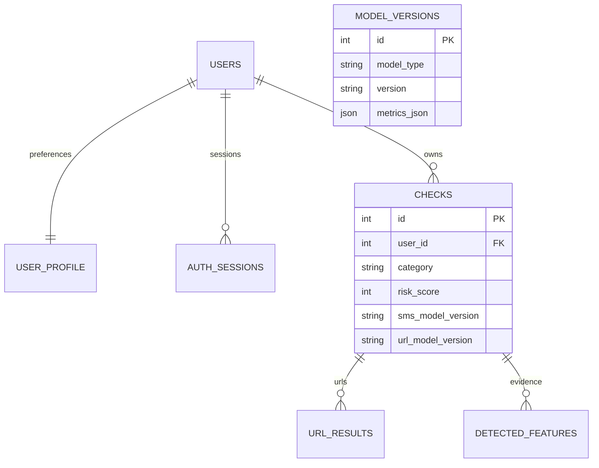
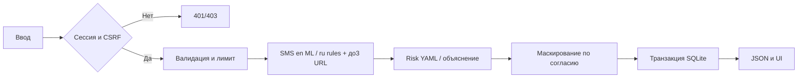
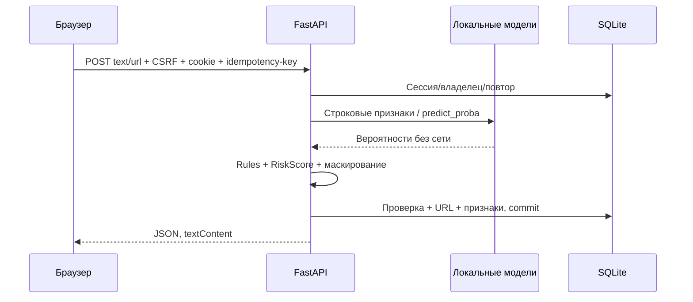

# SMS Guard — результат MVP, 06.11.2026

Исходные PDF, данные и SMS split этапов1–6 сохранены. Рабочий язык ML — английский; русский — правила и URL, без P_sms; казахский исключён DEV-01. Новая реализация использует FastAPI/SQLAlchemy/Alembic/SQLite/Jinja2/Bootstrap5/Chart.js. Документ фиксирует сделанное, а не заменяет незавершённые критерии положительными отметками.

| Этап | Фактически выполнено | Состояние |
|---|---|---|
|7|NB baseline, fit train, validation probabilities/метрики, joblib, predict_sms, reload, анализ5FN/5FP|Выполнено|
|8|NB/LR/calibrated SVM,3конфигурации каждого, validation F2 при Precision≥.85, ROC/PR, один финальный test, английский inference|Частично: полный GridSearchCV/ablation/refit не выполнены|
|9|22признака, IPv4/IPv6, Punycode/алфавиты, Levenshtein,17сокращателей,22бренда, валидация/объяснения,≥12тестов; HTTP/DNS запрещены|Выполнено|
|10|Оригинальный PhiUSIIL UCI, инверсия меток, очистка/дубликаты/конфликты,50тыс.подвыборка, domain-group split, parquet/индексы,6EDA-средних|Выполнено с фактическим отклонением долей строк из-за группировки|
|11|LR и RF,2конфигурации каждого, validation сравнение,2порога,ROC/PR,RF importance,20искусственных URL,один test,joblib/meta|Частично: целевые test-метрики не достигнуты; полный CV train не проведён|
|12|Две модели один раз при старте, общий анализ,до3URL,отдельныйURL,ru/en правила6групп×10фраз/язык,AnalysisResult|Выполнен рабочий сервис|
|13|YAML веса/пороги/overrides,0–100,рекомендации/предупреждение,калибровка EN validation,≥10граничных тестов|Частично: русский не калиброван; объяснения ранжируются по весовому вкладу, но не являются причинной атрибуцией|
|14|REST/auth/сессии/CSRF/лимиты/изоляция владельца/ошибки/503/логирование/OpenAPI;≥15API-тестов|Выполнен рабочий API|
|15|Jinja2 UI,fetch/loading/disable,3примера,счётчик,неактивныеURL,textContent,5экранов,360/768/1366|Выполнен рабочий UI; полного измерения контраста всех состояний нет|
|16|7таблиц,явная Alembic migration с нуля,транзакции/индексы/каскады,согласие/маскирование,фильтры/20стр/удаление,профиль/пароль,seed_demo30|Выполнено|
|17|SQL-агрегации,6карточек,категории/дни/top5/уровни/последние10,7/30/90,admin без чужих текстов,empty state|Выполнен Dashboard;1000строк измерены на API, не на полном browser render|
|18|114автотестов,coverage,security/API/browser/performance,модельный notebook,ошибки/графики,5live-сценариев,5скриншотов,README|Частично: академический комплект/видео/формальный каталог кейсов не завершены|

## Реальные метрики

Тест SMS:771строка,678ham/93spam; source UCI, прежний split3594/770/771. Положительный класс — **spam**, не юридически определённое мошенничество. F2 — критерий выбора при validation Precision≥.85, а не максимизация test. Для SVM калибратор5-fold обучает вложенный полный pipeline внутри каждого fold; scaler/TF-IDF не видят его calibration-fold при fit. NB/LR используют неизменённый train-fit FeatureUnion этапа6; MaxAbsScaler для линейных моделей сохраняет sparsity. NB получает только неотрицательные значения.

| Validation, лучшая конфигурация алгоритма |Precision|Recall|F1|F2|ROC-AUC|PR-AUC|
|---|---:|---:|---:|---:|---:|---:|
|NB alpha=.1|.946809|.967391|.956989|.963203|.993571|.979044|
|LR C=10,balanced,max_iter1000|.891089|.978261|.932642|.959488|.996008|.984940|
|Calibrated Linear SVM C=10|.918367|.978261|.947368|.965665|.997515|.989027|

Выбрана SVM; порог **0.11356167328234269**. Он зафиксирован до test; train+val refit не выполнялся, чтобы рабочий артефакт оставался именно оценённым. Test был зарезервирован эксклюзивным claim-файлом; повторный finalize запрещён. Повтор fit кандидатов на train/validation дал одинаковые probabilities SHA, выбор и порог. Test не использовался для адаптации моделей. PR-AUC — трапецеидальная площадь PR-кривой; Average Precision сохранена отдельно.

| Финальный test |Accuracy|Precision|Recall|F1|F2|ROC-AUC|PR-AUC|
|---|---:|---:|---:|---:|---:|---:|---:|
|SMS SVM|.985733|.936170|.946237|.941176|.944206|.996035|.985589|
|URL RF depth12|.771131|.642469|.743486|.689296|.720819|.844709|.835703|

CM (строки факт0/1, столбцы прогноз0/1): SMS `[[672,6],[5,88]]`; URL `[[3372,921],[571,1655]]`. SMS достиг Precision/Recall/F1≥.90. URL **не достиг** Precision/Recall≥.85 и ROC-AUC≥.90, реальные результаты не заменялись целевыми. На validation URL RF достигал Precision.853958/Recall.904985/F2.894298; перенос на независимые домены существенно хуже. Возможные причины — сдвиг долей классов/групп и сохранившееся смещение структуры путей источника. Это гипотезы, не доказанное причинное объяснение. В частности, возможны ложные тревоги на легитимные адреса.

## Паспорт URL-данных

Источник/авторы: Prasad,A. & Chandra,S.(2024), [PhiUSIIL UCI967](https://archive.ics.uci.edu/dataset/967/phiusiil+phishing+url+dataset), DOI10.1016/j.cose.2023.103545. Оригинальный ZIP скачан06.11.2026 в data/raw/phiusiil.zip, SHA-256 `0a639fd03aea6308c5b1c10c92aa23c2ce1505447a9137271865cd0badc9a59a`; лицензия CC BY4.0 согласно UCI. Структура: читаются только URL(str),label(int); готовые HTML/репутационные признаки исключены. Оригинал235795строк;8невалидных,84строки конфликтных групп,2201повтор;233502после очистки. После стратифицированной подвыборки —50000,21133phishing/28867legitimate. UCI label1=legitimate инвертируется в0.

GroupShuffleSplit(seed42) по registrable domain: train33360(phishing13150),val10121(5757),test6519(2226), без пересечения доменов. Доли строк66.72/20.24/13.04% отличаются от70/15/15, поскольку делятся группы, не строки. Приоритет — отсутствие утечки доменов; баланс честно отражён. Файлы `url_features.parquet`/`url_split.json` — локально data/processed. Scheme и www приводятся к единому виду при train/inference для снижения артефактов; это не устраняет все особенности источника. Flagged TLD — эвристический перечень из ТЗ, не репутационный факт. Модельный контракт v1 заморожен; уточнение разбора зарезервированных .test/.example используется только для правил/показа, не меняет оценённые признаки модели.

## Русский и риск

Собственный100ru/50–50 корпус использован один раз после фиксации правил, моделей и порогов **только для итоговой проверки**. P_sms нигде не вычислялась. Rules+URL на уровне medium+: Accuracy.74/Precision.785714/Recall.66/F1.717391,CM`[[41,9],[17,33]]`. Набор искусственный, AI-разметка без независимой экспертизы; это не доказательство русской ML-поддержки. Полноценный ru ML не заявляется. После проверки правила/пороги не подбирались по этому набору.

Калибровка риска — только английская validation:3варианта весов; выбраны .5/.3/.2,границы22/70. Recall medium+ .956522,ложные высокие0%. Для отдельного URL риск отображается в диапазоне его категории t1/t2; отсутствие SMS не уменьшает категорию URL. Структурные overrides могут только повышать риск. Для SMS формула не менялась. Граница35 была исходной,22подобрана по заданию13.4; это явно отражено в risk_config.yaml. Независимое качество совокупного риска на реальном русском потоке не подтверждено. Отдельный старый ml/rules.py сохраняется для неизменности ML-признаков; расширенный runtime-словарь расположен в app/analysis/social.py.

## Артефакты и проверки

- `ml/artifacts/sms_baseline.joblib` + meta: NB alpha1,threshold.5; отдельный baseline.
- `sms_model.joblib` + `sms_model_meta.json`: полный калибратор с вложенным preprocessing/FeatureUnion/scaler/SVM, версия1.0.0,источник/хеши/порог/дата/validation/test.
- `url_model.joblib` + `url_model_meta.json`: RF и числовые признаки; исходная нормализация и фиксированный контракт — в ml/url_features.py.
- joblib/сырые данные/SQLite/логи вне Git. В текущем workspace все модели и данные присутствуют. На другом компьютере они должны быть перенесены из доверенного источника или заново обучены в отдельном эксперименте; чистое удалённое клонирование с автозагрузкой моделей не реализовано.
- `notebooks/02_models.ipynb` выполнен: comparison/ROC/PR/CM,5FN+5FP по cached test-predictions,20URL,важность RF,новый процесс inference. Подробности в docs/reports/*.json. Исторический EDA01 не повторялся.
- После нового процесса SMS предсказания совпадают точно; URL — с допуском1e-12. SMS одиночный inference median10.72мс,p9511.88мс на синтетическом en-примере.
- Полный pytest **114passed in32.84s**, coverage **78%** приложения+ML; ML **около70%**,risk98%. Полные данные: final_tests.xml/final_coverage.json. Это покрытие текущего кода, не гарантия качества безопасности.
- Ruff/pip check/compileall/Alembic check проходят; отдельный тест применяет явную схему миграций к пустой SQLite.
- Edge:5скриншотов,360/768/1366без горизонтального переполнения,без page errors;внешние запросы браузера заблокированы. Login/logout/защита истории проверены. docs/screenshots/.
- 100реальных API-анализов:p5013.25мс,p9593.39мс,max116.65мс. SQL Dashboard на1000записях —.021с API.900строк нагрузки явно синтетические фикстуры во временной БД, не вымышленные результаты модели.
- Защита:PBKDF2-SHA256600000+salt,opaque hashed/revocable sessions,CSRF/HttpOnly/SameSite/SecureHTTPS,5ошибок→60с,30анализов/мин,owner-scoped404,ORM,textContent/autoescape,идемпотентный ключ,privacy=false по умолчанию,маскирование в том числе URL-параметров внутри SMS,SQL-параметры скрыты в ошибках,тексты/пароли не логируются.

## Оставшиеся обязательные пункты / ограничения

1. URL не достиг целевых test-метрик; русский rules+URL Recall.66 также ниже языкового ориентира. Улучшение требует независимых данных/нового протокола, текущий test не используется для дальнейшего подбора.
2. Полный GridSearchCV на5train-fold для всех алгоритмов SMS/URL и ablation word/char/stopwords не проведены; выполнена малая фиксированная сетка train/validation,5-fold применяется к SVM-калибровке. LR-коэффициенты не опубликованы отдельно.
3. Финальный train+val refit не выполнен: рабочая модель сохранена именно в оценённом состоянии. Новый refit-артефакт нельзя автоматически снабдить этими test-метриками.
4. Совокупный риск не калиброван на независимых русских данных; объяснения ранжируются по эвристическому весовому вкладу; это не причинная атрибуция модели.
5. Не выполнены полный аудит контраста всех UI-состояний, точный browser-render benchmark при1000записях, формальный каталог≥40кейсов с отдельными предусловиями/шагами и полная ФТ/НФТ→case матрица. Есть114автотестов/assertions,JUnit,API/браузер/нагрузочные результаты.
6. Записка40–60страниц,3–5мин видео защиты и remote-репозиторий не подготовлены. Один итоговый MVP-коммит вместо отдельных коммитов7–18 принят в текущем MAX SPEED процессе. Docker не использован.

## Диаграммы текущей реализации

