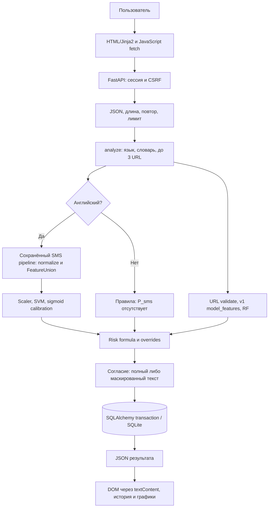

# 02. Как SMS Guard работает от начала до конца

## Проблема и словарь

SMS Guard — рекомендательная система: принимает сообщение или адрес и оценивает признаки угрозы. **Spam** — нежелательная массовая рассылка; **smishing** — фишинг через SMS; **phishing** — обман для получения данных/действий; **fraud** — мошенничество, более широкая категория обмана. Рекламная рассылка может быть spam без кражи денег. Поэтому UCI spam нельзя без оговорки называть юридически размеченным fraud.

Проект — **монолит**, то есть один веб-сервис с модулями, а не несколько независимо развёртываемых сервисов. FastAPI принимает HTTP, SQLAlchemy работает с SQLite, Jinja2 формирует HTML, Bootstrap задаёт оформление, JavaScript вызывает API, Chart.js рисует статистику. Сохранённые модели scikit-learn исполняются локально. Все компоненты работают в одном процессе локального сервера; SQLite — файл базы, не отдельный сервер БД.

## Фактический путь сообщения

Предобработка не стоит отдельным общим блоком до правил: язык, runtime-словарь и ссылки читают исходный текст. Нормализация для английского ML находится **внутри** сохранённого pipeline. URL анализируется собственной веткой. Для отдельного URL SMS-модель вообще не вызывается, а score отображается из пороговых диапазонов URL-модели.

1. `static/js/app.js:init` перехватывает submit: `preventDefault` отменяет обычную отправку формы, кнопка блокируется, показывается индикатор. `api()` отправляет JSON и CSRF-заголовок с cookie-сессией. `crypto.randomUUID()` даёт ключ повторной отправки.
2. `app/web.py:check_sms` зависит от `current_user` и `csrf`, затем вызывает `perform`. Проверяются тип/длина, управляющие символы, существующий idempotency key (ключ идемпотентности: повтор не создаёт новую запись), лимит 30/мин.
3. `app/analysis/services.py:analyze` определяет ru при наличии русской кириллицы, иначе en при наличии латиницы, иначе other. Это эвристика, не языковая ML-модель. Русский текст с английским URL остаётся ru; чисто неязыковые символы дают other.
4. `app/analysis/social.py:matched_groups` нормализует NFKC/lower и ищет фразы шести групп регулярными выражениями с границами слова. Это сигнал социальной инженерии, а не доказательство намерения отправителя.
5. Для en `ModelStore.predict_sms` вызывает `predict_proba`. Внутри — lower/NFKC и токены сущностей, word/char TF-IDF и шесть ручных признаков, MaxAbsScaler, линейная SVM и sigmoid-калибратор. `label` — сравнение P с порогом, сама вероятность не равна метке.
6. Regex `ml.preprocessing.URL` находит до 3 ссылок. `analyze_url` проверяет формат, получает объяснимые флаги публичного extractor и вероятность RF через frozen `model_features`. Никакого обращения к адресу нет. В список включаются вероятности каждого URL, `p_url_max` — их максимум.
7. `compute_risk` объединяет доступные P и число групп. Отсутствующий SMS или URL исключается из соответствующего веса; социальные признаки остаются. Затем применяются нижние границы риска для запроса кода, двух сильных моделей и структурной маскировки.
8. API сохраняет `Check` с дочерними `UrlResult` и `DetectedFeature` одной транзакцией. Без согласия полный текст не сохраняется, телефон/карта/сумма маскируются; чувствительные параметры ссылок внутри SMS тоже маскируются. Это не полная анонимизация.
9. `serialize` добавляет ID, UTC-дату и разрешённый вариант ввода. JavaScript строит DOM через `textContent`; найденные адреса остаются текстом, не ссылками.
10. При открытии истории API выбирает только владельца. Dashboard делает SQL-агрегации по периоду; после новой проверки данные обновляются при переходе на Dashboard, без WebSocket (постоянного двустороннего соединения).

## Старт процесса и обучающий контур

`python -m app` сначала применяет Alembic, затем запускает Uvicorn на 127.0.0.1:8080. `create_app` создаёт приложение; `lifespan` — контекст его жизни — открывает БД и загружает ModelStore один раз. Таблица ModelVersion обновляется из metadata. При отсутствии моделей health сообщает false, соответствующая проверка возвращает 503. Страницы всё ещё доступны.

Обучение отделено от запросов пользователя. `sms_experiment.py` использует фиксированные train/validation, а `finalize` один раз оценивает test. `url_experiment.py` готовит локальный PhiUSIIL и обучает LR/RF. Эти команды **не запускать на защите**: уже существующие test-claims запрещают повтор, а новый эксперимент требует отдельного протокола. Notebook02 при запуске тоже повторно обучает URL-сравнение; для показа достаточно сохранённых результатов.

## Формула риска: объяснить у доски

Пусть p_s — вероятность spam, p_u — максимальная вероятность URL, k — число групп. S=min(k/3,1). Для имеющихся компонент R=round(100·Σw_i·x_i/Σw_i), где веса sms=.5, url=.3, se=.2. Компонент социальной инженерии равен 0 даже при отсутствии групп и входит в знаменатель. После формулы overrides могут поднять R.

Пример без ссылки: p_s=.6, k=1 → 100·(.5·.6+.2/3)/(.5+.2)=52.38 →52. При русском p_s отсутствует: k=1, нет URL →33.33→33; запрос кода поднимает минимум до 70. При k=2 без URL/ML →67, поэтому семейная просьба о переводе может остаться средней. Текущие уровни:0–21 LOW,22–69 MEDIUM,70–100 HIGH; граница 22 выбрана на EN validation, исходная PDF35 отдельно зафиксирована в отклонении.

Для отдельного URL `compute_url_risk` линейно отображает интервалы P<t1, t1≤P<t2, P≥t2 в соответствующие диапазоны score и затем берёт максимум с базовым/структурным риском. Это специальная эвристика, а не доказанная вероятность мошенничества. Ранжирование причин по весу — не причинная атрибуция модели.

## Как коротко объяснить архитектурные решения

- FastAPI разрешён PDF; Django не требуется при выбранной альтернативе. ORM (объектно-реляционное отображение) SQLAlchemy связывает классы с таблицами.
- SQLite удобен для одного локального процесса и демонстрации; конкурирующие записи и масштабирование ограничены. В проекте не проверена готовность к большой нагрузке.
- Классические ML-модели подходят небольшому английскому корпусу и разреженным n-граммам; URL имеет 22 табличных признака. Нейросеть сама по себе не решает проблему отсутствующих русских данных.
- Никакого автоматического доверия категории SAFE; есть предупреждение и рекомендации. Детальная карта функций — в [03](03_code_map.md), реальные результаты — в [06](06_models_and_metrics.md).
